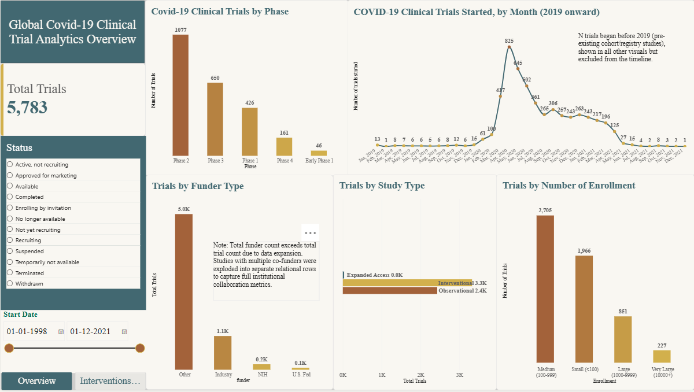
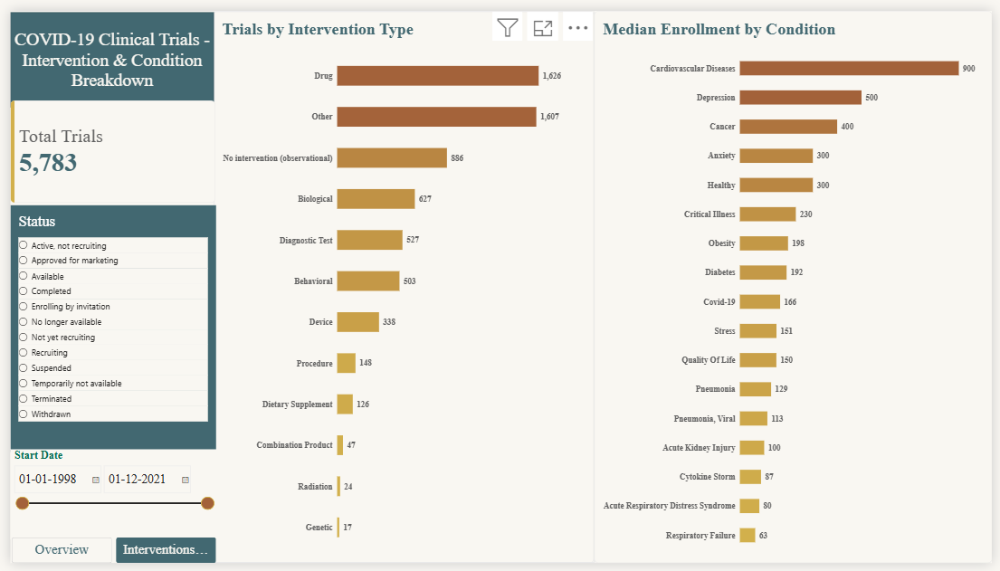

# COVID-19 Clinical Trials: Data Cleaning, SQL Analysis, Power BI Dashboard & LLM Text-to-SQL Engine

> **Project at a Glance:** 
> - **5,783** Clinical trials analyzed
> - **5** Relational tables modeled
> - **2** Interactive Power BI pages
> - **35** LLM evaluation test questions (25 regression + 10 held-out)

An end-to-end analytics and AI evaluation project on 5,783 COVID-19 clinical trials registered on ClinicalTrials.gov. I cleaned messy registry data, restructured it into linked relational tables, analyzed it with SQL (DuckDB), presented the results in an interactive Power BI dashboard, and evaluated a local LLM (Qwen via Ollama) to build an automated Text-to-SQL natural language query engine with regression testing.




## Why this project

Real registry data is messy: several values packed into one cell, inconsistent spellings, free text, placeholder dates. I wanted a project that shows the whole workflow (clean, model, analyse, visualise) and, just as important, documents the judgment calls made along the way instead of hiding them.

## Tools

- **Python** (pandas) for cleaning and feature engineering
- **DuckDB** for SQL analysis (joins, aggregations, outlier checks)
- **Power BI Desktop** for the dashboard (data modelling, DAX measures)
- **matplotlib / seaborn** for exploratory charts
- **Ollama (Qwen LLM):** Local LLM integration enabling Text-to-SQL querying and natural language data extraction.
- **Jupyter notebooks** in VS Code

## Data

- Source: the Kaggle dataset [COVID-19 Clinical Trials](https://www.kaggle.com/datasets/parulpandey/covid19-clinical-trials-dataset), which is derived from ClinicalTrials.gov
- 5,783 trials, 27 columns
- **The snapshot ends on 2021-04-14** (latest "First Posted" and "Last Update Posted" date). The sharp drop in trial starts after April 2021 reflects this cutoff, not a decline in COVID-19 research.

## Workflow

1. **Clean:** fix data types, standardise categories, handle nulls
2. **Normalise:** split multi-value columns into their own tables
3. **Engineer features:** derive new columns for analysis
4. **Analyse:** SQL queries across the linked tables
5. **Visualise:** two-page Power BI dashboard

### Data model

The original flat file became one main table plus four linked tables, joined on the trial ID (`NCT Number` / `nct_number`):

| Table | One row per | Why it exists |
|---|---|---|
| `trials` | trial | Core attributes, plus derived columns |
| `conditions` | trial + condition | `Conditions` held several values per cell |
| `interventions` | trial + intervention | Split into type and detail |
| `funders` | trial + funder | Multiple funder types per trial |
| `phases` | trial + phase | Some trials span two phases |

Because these tables are exploded, **row counts are not trial counts**. All trial counts use `COUNT(DISTINCT ...)` in SQL and `DISTINCTCOUNT` in DAX.

## Cleaning and modelling decisions

| Issue | What I did | Why |
|---|---|---|
| `Phases` was missing for 2,461 trials | Checked the pattern first: every missing value belonged to an observational or expanded-access study (interventional trials had none missing). Filled with "Not Applicable". | The nulls are structural (phases only apply to interventional studies), not random gaps. |
| Dates stored as text, some with month and year only | Converted to datetime. Month-only dates default to the 1st of the month. | Needed for duration and timeline analysis. Day-level precision is not available for every trial. |
| Placeholder completion date `2099-12-31` | Excluded from duration calculations and flagged in a column | It is a "no end date" placeholder, not a real date. It inflated the maximum duration to about 80 years. |
| Many spellings of COVID-19 (`covid19`, `COVID`, `SARS-CoV-2`, `2019-nCoV`, ...) | Regex-based normalisation into one `covid-19` label, with an exclusion for "non-covid". Review of results caught missed variants and false matches (for example "cov" matching "recovery"). | Exact-match dictionaries missed too many variants. |
| ARDS spelled several ways | Merged the variants into one label, with word boundaries so words like "stewardship" are not caught | Prevents splitting one condition across several rows in rankings. |
| Duplicate rows after merging spellings | Dropped duplicate trial and condition pairs | A trial listing `COVID-19` and `SARS-CoV-2` would otherwise count twice. |
| `Interventions` combined type and description (`Drug: Hydroxychloroquine`) | Split into `intervention_type` and `intervention_detail`; trials with no intervention are labelled "No intervention (observational)" | All trials with no listed intervention are observational studies. |
| `Age` was free text (`18 Years to 65 Years (Adult, Older Adult)`) | Parsed into `min_age`, `max_age` (in years) and `population_group`. Handled "and older", "up to" and months/days. | Gives numeric, comparable fields. A missing `max_age` means no upper limit. |
| Very large enrollment values | Used medians instead of averages in the analysis and dashboard, and added a "Very Large (10000+)" enrollment bucket | A handful of population-scale studies skew averages badly (see below). |
| Pre-2019 start dates (82 trials) | Kept in the data, excluded only from the timeline chart | They are legitimate pre-existing cohort or registry studies that later became part of COVID-19 research. |

## Derived features

- `trial_duration_days`: completion date minus start date
- `min_age`, `max_age`, `population_group`
- `enrollment_bucket`: Small (<100), Medium (100-999), Large (1,000-9,999), Very Large (10,000+)
- `Clean_Study_Type`: Expanded Access variants grouped into one category (Power BI)

## Key findings

- **Phase 2 is the largest phase** (1,077 trials), followed by Phase 3 (650), Phase 1 (426), Phase 4 (161) and Early Phase 1 (46). Trials spanning two phases are counted in each. The pattern is consistent with many candidate treatments being tested early and fewer advancing to later phases.
- **Trial starts spiked in spring 2020** and tapered through 2021.
- **Typical trials are short and small.** The median duration is 297 days (about 10 months) against a mean of 417 days, so a tail of long studies pulls the average up.
- **Study types:** 3,322 interventional, 2,427 observational, 34 expanded access.
- **Medians tell a different story than averages.** Obesity-tagged trials have a median enrollment of 198 but an average of about 80,000, because one study (NCT02788903) enrolled 2,000,000 participants. Several studies enrolled 1 million or more, mostly population-level or digital studies (symptom trackers, national test-database analyses, surveillance), not traditional clinical trials.
- **Secondary conditions:** after COVID-19 itself, ARDS, anxiety, depression and pneumonia are among the most frequent conditions, showing both respiratory complications and mental-health research.
- **Funding:** most trials fall under the registry's "Other" funder category, with Industry next. Funder counts add up to more than the trial total because co-funded trials appear under each funder.
- **Interventions:** Drug and Other are the most common intervention types. 886 trials list no intervention, and all of them are observational studies.

## Dashboard

- **Covid_Overview:** total trials, trials by phase, monthly trial starts (2019 onward), funders, study type, enrollment size, with slicers for status and start date
- **Interventions_and_Conditions:** median enrollment by condition (top conditions), intervention types, with slicers synced across pages

## Limitations

- The data is a snapshot ending 2021-04-14. It cannot show later trends.
- Condition normalisation uses pattern matching for COVID-19 and ARDS variants. The long tail of rare conditions (2,000+ distinct values) was left as entered.
- About 520 start dates were month-only in my first run, so day-level precision is approximate for those trials.
- Six trials with unusual age units (minutes, hours, weeks) were left unparsed. That is about 0.1% of the data.
- `Outcome Measures` is almost entirely free text and was not analysed.
- Narrowing the date slicer in Power BI drops trials with no start date (about 34), including most expanded-access studies.


## Natural-language query layer (local LLM)

Ask a question in plain English, and a local model writes DuckDB SQL, runs it, and returns a table. The model (`qwen3.5:4b` through Ollama) runs fully on my laptop GPU (RTX 4050, 6 GB), so no data leaves the machine. Although this project uses public registry data, I explored a local-first architecture to understand how LLM-assisted querying could minimise external data sharing. This prototype is not validated for production use with sensitive data

I treated this as an evaluation project as much as a build: the goal was to find out where a small local model can be trusted and where it can't.

### Run Settings
- **Model:** `qwen3.5:4b` via Ollama
- **Temperature:** `0` (for maximum determinism and minimal hallucination)
- **Context Window (`num_ctx`):** `6144` tokens
- **Reasoning/Thinking:** Disabled (`thinking off`) to reduce latency and prevent context window exhaustion
- **Execution Limits:** Up to 3 automated retry attempts with error feedback


### How it works

1. **Schema from the database.** The prompt's schema and the list of allowed values for categorical columns (status, gender, phase, funder, and so on) are generated from DuckDB, so they can't drift from the data.
2. **A cleaned view (`v_trials`).** It hides the raw multi-value columns and bakes in the data caveats I found during cleaning: the `2099-12-31` placeholder becomes NULL, missing gender becomes its own "Missing" category, and Expanded Access variants are grouped.
3. **Domain rules and worked examples** in the system prompt, each added after a specific observed failure (frozen as `prompts/system_prompt_v1.txt`).
4. **Guardrails.** Only a single `SELECT`/`WITH` statement is allowed and write keywords are blocked. The generated SQL is always printed so a human can read it. Up to 3 attempts, with the DuckDB error fed back to the model. Empty results and wrongly shaped "how many" answers are treated as failures.
5. **Thinking mode off.** On one question the model's reasoning used the whole 6,144-token context and it returned an empty answer. Turning thinking off also made simple queries about 20x faster (0.4 s vs 9 s).

### Evaluation

Each test question has a hand-written reference query on the raw tables. Results are compared by value (column names ignored, and extra columns allowed when the reference returns a single column).

| Test set | Purpose | Result |
|---|---|---|
| Regression suite (25 questions) | Prompt was tuned on these, so this checks that fixes hold. It is not an accuracy estimate. | 22/25 strict, 23/25 after review (one miss was only a label difference: "Female-only" vs "Female") |
| Held-out set (10 questions) | Written after the prompt was frozen | 7/10 as scored by the script, **6/8 valid questions** after auditing the test set |

**Auditing the held-out set.** Two questions were excluded: one referred to an enrollment bucket that doesn't exist, and one had a tie at the cut-off, so it had no single right answer. Three reference queries also had to be corrected after the first run (one wrong label, two answer-shape mismatches), so this set is not perfectly blind. With only 8 valid questions, I report counts and not percentages.

### What went wrong (and what it taught me)

| Failure type | Example | Cause / fix |
|---|---|---|
| Wrong column for a vague word | "Posted in Q1 2020" used `start_date` instead of `first_posted` | A data dictionary in the prompt, one line per column |
| Invented filters | "Exclusively 65 and above" added unrequested `min_age`/`max_age` conditions, which pulled in unrelated trials | A rule in the prompt was ignored. A small model drops rules when a question has several parts. |
| Multi-step logic | "Smallest and largest median enrollment" returned the whole ranking. "Percentage within a subset" was built wrongly. | Route these questions to vetted query templates (v2) |
| Retries masking errors | A percentage question hit a SQL error, the retry "fixed" the syntax, and the query then returned **65,000%** | Retries repair syntax, not meaning. Add plausibility checks (a percentage must be between 0 and 100). |

Earlier failures that were fixed along the way:
- The model invented a category value (`'Other'` gender) and a shortcut (`phase = 'Not Applicable'` for observational studies). Listing the real values in the prompt fixed both.
- Missing ages were turned into 0, which silently corrupted averages.
- "Both A and B" returned one row per trial instead of a count.
- The model picked a raw multi-value column over the normalised table. Hiding it from the schema fixed that.
- Condition spellings (about a dozen for diabetes) were a data problem, not a prompt problem. I fixed it in the cleaning step with an anchored pattern.

### Takeaways

- A 4B local model handles single-intent questions well and is unreliable on multi-step ones. Silent, plausible-but-wrong answers are the real risk, so the printed SQL matters more than the answer.
- The strongest fixes were in the data layer (a clean view, normalised conditions), not in more prompt rules.
- Test sets need auditing too. References that returned zero rows or zero counts were typos in my test, not model failures.
- This is not something to run unattended. Read the SQL before trusting a number.

### Next steps (v2)

- Have the model choose and fill in a small set of vetted query templates instead of writing free-form SQL
- A data dictionary in the prompt and plausibility checks on results
- Compare against a larger model on the same questions

## How to reproduce

1. Download the dataset from Kaggle and place the CSV in `data/raw/covid19_clinical_trials.csv`
2. `pip install pandas duckdb matplotlib seaborn`
3. Run the notebook(s) in `notebooks/` from top to bottom in one pass. The last cell exports the cleaned tables to `data/clean/covid19_clinical_trials_cleaned.csv`.
4. Open `powerbi/clinical_trial_bi.pbix` file. If the data path differs, use Home, Transform data, Data source settings, Change Source, and point it to the `data/clean/covid19_clinical_trials_cleaned.csv` folder.

## Reproducing the LLM layer

**Requirements**
- Python with `pandas`, `duckdb` and `ollama` (`pip install pandas duckdb ollama`)
- [Ollama](https://ollama.com) installed and running
- A GPU with about 4 GB of free VRAM is enough (the model used 3.3 GB at a 6,144-token context). It also runs on CPU, but much more slowly.

**Steps**

1. **Get the model.**
   ```
   ollama pull qwen3.5:4b
   ```
   The results in this README were produced with the model ID `d8b0f5e9760c` (check yours with `ollama list`). If your ID differs, scores may differ slightly.

2. **Load the cleaned tables into DuckDB.** Create one in-memory table per CSV in `data/clean/covid19_clinical_trials_cleaned` (`trials_cleaned.csv`, `conditions.csv`, `interventions.csv`, `funders.csv`, `phases.csv`). Name the first one `trials` and the rest by file name.

3. **Open `notebooks/04_Duck_Datebase_and_LLM.ipynb` and run it top to bottom.** It creates the cleaned view `v_trials`, builds the schema and value hints from DuckDB, assembles the system prompt, and defines the guard and the `ask()` function. The prompt text that was evaluated is saved in `prompts/system_prompt_v1.txt`. It is a rendered snapshot of what the notebook generates.

4. **Ask a question.**
   ```python
   print(ask("How many trials are in each phase? Ignore 'Not Applicable'."))
   ```
   The generated SQL is printed above each result. Read it before trusting the number.

**Settings used for the reported results**

| Setting | Value |
|---|---|
| Temperature | 0 |
| Context window (`num_ctx`) | 6144 |
| Thinking mode | off on every attempt |
| Attempts per question | up to 3, with the DuckDB error fed back |

**Re-running the evaluation**
```python
from eval_suite import EVAL, EVAL2, HELD_OUT, EXCLUDED, preflight, run_suite

preflight(EVAL + EVAL2 + HELD_OUT, con)           # checks the reference queries first
run_suite(EVAL + EVAL2, con, ask)                 # expected: 22 / 25
run_suite(HELD_OUT, con, ask, excluded=EXCLUDED)  # expected: 6 / 8
```
Raw outputs from my runs are in `eval/results/`. At temperature 0 the output should be repeatable on the same setup, but different hardware, Ollama versions or model builds can change individual answers.

**Troubleshooting**
- The first question takes a minute or two while the model loads. After that, answers take a few seconds. Check `ollama ps` shows the model on 100% GPU.
- If answers come back empty, make sure thinking is off. With thinking on, the model can use up the whole context window and return nothing.

## Repository structure

```
.
├── data/
│   ├── raw/        # original CSV (never modified)
│   └── clean/      # trials_cleaned, conditions, interventions, funders, phases
│── eval/           # eval suite and results (regression and held_out)
├── notebooks/      # cleaning, feature engineering, SQL analysis, charts
├── powerbi/        # dashboard (.pbix)
├── images/         # dashboard screenshots
└── README.md
```


## About

Built by **Yamini P.**, an aspiring Data Analyst with a background in healthcare and clinical study operations.

Interested in data analytics, SQL, business intelligence, and practical applications of AI.

**Connect with me:**

- **LinkedIn:** (https://www.linkedin.com/in/yamini-p-713083203)
- **GitHub:** (https://github.com/Yamini-P-24)
- **Email:** [yaminip024@gmail.com]
